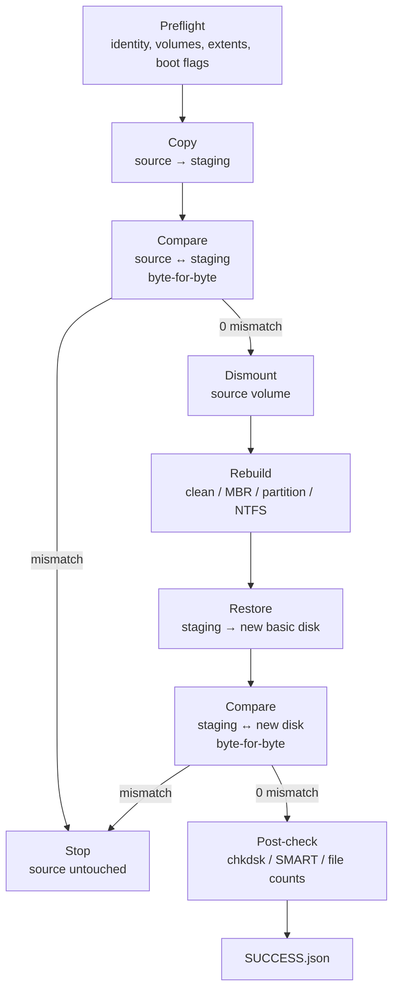

# Disk Migration Kit

[简体中文](README.zh-CN.md) | [English](README.en.md)

> A verifiable, fail-closed workflow for migrating a Windows LDM dynamic disk to a basic MBR disk.  
> Portable GUI + PowerShell scripts + a byte-for-byte comparator.


> **Destructive operation warning**  
> This tool erases the target physical disk. Use it only on a non-system/non-boot disk. Back up first and test on a VM or a disposable disk. Do not use it as a one-click "dynamic to basic" converter.

---

## 1. The problem

Windows does not provide a safe in-place conversion from a dynamic disk to a basic disk when the disk contains data. Disk Management and `diskpart` require deleting all volumes first, which is destructive.

Worse, a dynamic volume can consist of multiple **extents**, and their physical order may not match the logical order. A real-world layout can look like this:

- logical extent 0 is at a high physical address;
- logical extent 1 is at a low physical address;
- the volume bytes are read from the high segment first, then wrap back to the low segment.

A single contiguous MBR partition cannot describe that layout. Changing the MBR partition type from `0x42` (LDM) to `0x07` and pointing it at the low address can make NTFS read from the wrong volume start and corrupt the file system.

The reliable route is therefore:

```text
copy → full byte-for-byte verify → rebuild as MBR/basic → restore → verify again → chkdsk
```

Core rule: **never wipe the source disk until the staging copy has passed a full comparison.**

---

## 2. Workflow



| Stage | Action | Writes source? |
|---|---|---|
| 0. Preflight | model, serial, firmware, size, boot flags, volumes, extents, free space | no |
| 1. Copy | Robocopy to an independent staging disk | no |
| 2. Compare | full byte-for-byte comparison | no |
| 3. Rebuild | dismount, DiskPart clean, initialize MBR, create partition, format NTFS | **yes, destructive** |
| 4. Restore | copy from staging to the new basic disk | writes new disk |
| 5. Compare | full byte-for-byte comparison again | no |
| 6. Post-check | `chkdsk /scan`, SMART, counts, success marker | no |

---

## 3. Features

- **Portable WinForms GUI**: no installer, extract and run.
- **Guided 1-to-7 steps**: preflight, copy, verify, rebuild, restore, verify, post-check.
- **Bilingual UI**: Chinese / English, persisted across restarts.
- **Two-disk mode**: staging and recovery may share one root; `DATA` and `logs` stay separate.
- **Identity gates**: model + serial + firmware + size + boot flags; disk number alone is not enough.
- **Fail-closed**: any mismatch, space problem, unhealthy volume or identity mismatch stops the workflow.
- **DiskPart safety**: uses `diskpart /s` command files instead of racing interactive stdin.
- **Evidence chain**: preflight JSON, copy logs, compare progress CSV, chkdsk output, success/failure JSON.
- **Recovery-aware**: if a volume is only dismounted/offline, `online volume` + `assign letter` can restore the mount without formatting.

The project is **not** an in-place converter. It needs a healthy staging location large enough for the data.

---

## 4. Verified behavior

The workflow has been validated with the following invariants:

| Item | Result |
|---|---|
| Source copy | completed |
| Source → staging full comparison | 0 mismatch |
| Rebuilt file system | NTFS / Healthy |
| Staging → new disk full comparison | 0 mismatch |
| `chkdsk /scan` | no problems, 0 bad sectors |
| Final disk | MBR basic disk |
| SMART | no new uncorrected read errors |

No machine-specific counts, sizes, dates, disk models or serial numbers are published in this repository.

---

## 5. Repository layout

```text
docs/          Chinese deep-dive docs; English index at docs/README.en.md
scripts/       PowerShell workflow
app/           WinForms GUI source, build.ps1, package.ps1
examples/      Sanitized config example
```

Key docs:

- [docs/01-scope-and-principles.md](docs/01-scope-and-principles.md) — scope and design principles
- [docs/02-architecture.md](docs/02-architecture.md) — architecture and data flow
- [docs/03-safety-model.md](docs/03-safety-model.md) — safety gates and threat model
- [docs/04-runbook.md](docs/04-runbook.md) — step-by-step runbook
- [docs/05-verification.md](docs/05-verification.md) — verification model
- [docs/06-diskpart-postmortem.md](docs/06-diskpart-postmortem.md) — DiskPart failure postmortem
- [docs/07-recovery-playbook.md](docs/07-recovery-playbook.md) — recovery playbook
- [docs/08-limitations.md](docs/08-limitations.md) — limitations
- [docs/09-operations-timeline.md](docs/09-operations-timeline.md) — sanitized timeline
- [docs/10-faq.md](docs/10-faq.md) — FAQ

English index: [docs/README.en.md](docs/README.en.md).

---

## 6. Quick start

> Read the safety model and runbook first. Do not test on your only copy of data.

1. Extract the portable package completely.
2. Run `EDiskMigration.exe` and approve UAC.
3. Select the target disk, source volume (any NTFS volume, not necessarily E:), working folder and recovery folder.
4. For a two-disk machine, keep “Use one root folder for staging and recovery” checked. The layout becomes:

   ```text
   <ROOT>\
   ├─ DATA\          staging data
   ├─ logs\          logs and compare results
   ├─ manifests\     preflight reports
   └─ postcheck\     final reports
   ```

5. Run steps 1→7 in order. Step 3 must report 0 mismatch before step 4 becomes available.
6. Step 4 requires typing the full target serial and checking the confirmation box.
7. After success, reboot once and keep the staging copy until key applications have been verified.

Build from source:

```powershell
.\app\build.ps1
.\app\package.ps1
```

Output: `dist\EDiskMigration-portable-YYYYMMDD.zip`.

---

## 7. Safety model

| Gate | Check | On failure |
|---|---|---|
| G0 | Administrator/SYSTEM | stop |
| G1 | target model + serial + firmware + size | stop |
| G2 | target is not boot/system | stop |
| G3 | source volume is healthy NTFS | stop |
| G4 | staging space is sufficient | stop |
| G5 | source ↔ staging 0 mismatch | stop; source untouched |
| G6 | no cancel flag | stop |
| G7 | DryRun by default | no writes |
| G8 | explicit Execute + serial confirmation | no writes |

Never:

- run `clean` or `format` after a failed DiskPart call without inspecting the disk;
- use `/MIR` or `/PURGE` on a staging copy;
- bypass antivirus to force a comparison to pass;
- use the tool on a system/boot disk, RAID, Storage Spaces or BitLocker without a dedicated plan;
- delete the only backup immediately after migration.

---

## 8. Limitations

- Single-disk LDM simple volume only; no cross-disk extents, RAID, Storage Spaces or BitLocker.
- Non-system/non-boot disks only.
- MBR target is limited to 2 TiB.
- NTFS is the validated file system.
- Online copying is not an application-consistent snapshot.
- Live logs, caches and antivirus can produce mismatches; classify them explicitly.
- This is a reference implementation, not a production-certified data recovery product.

---

## 9. Privacy

This repository contains no:

- disk images or user files;
- machine names, user names or personal paths;
- real disk serial numbers or models;
- logs, inventories, compare CSVs or screenshots from a real computer.

See [SECURITY.md](SECURITY.md) and [CONTRIBUTING.md](CONTRIBUTING.md) before publishing your own fork.

---

## 10. License

MIT. See [LICENSE](LICENSE).

---

## 11. 中文

完整中文说明：[README.zh-CN.md](README.zh-CN.md)。
