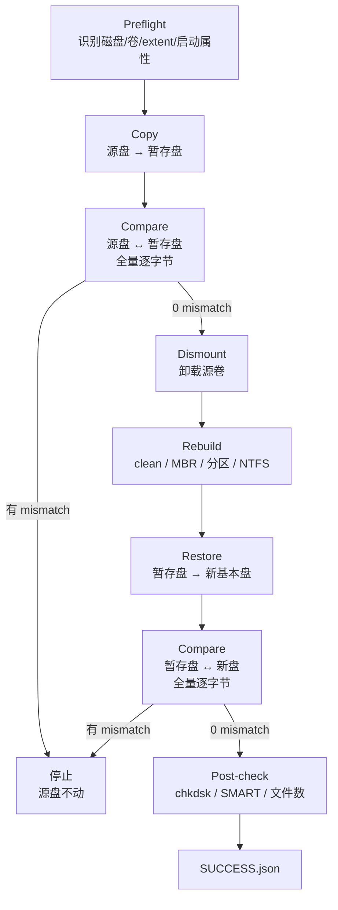

# Disk Migration Kit（简体中文）

[简体中文](README.zh-CN.md) | [English](README.en.md)

> 将 Windows 动态盘（LDM）安全迁移为 MBR 基本盘的可验证工具包  
> A verifiable, fail-closed workflow for migrating a Windows dynamic disk to a basic MBR disk.


> **危险操作警告**  
> 本项目包含会清空整块物理磁盘的脚本。请先在虚拟机、克隆盘或可丢弃的测试盘上验证。  
> 不要把本项目当作“一键动态转基本”工具；它做的是**数据迁移 + 重建基本盘 + 回拷校验**。  
> 使用前必须准备独立备份，并确认目标盘序列号。作者不对数据丢失负责。

---

## 1. 这个项目解决什么问题

Windows 的“动态盘转基本盘”不是无损操作。图形界面和 `diskpart` 都要求先删除所有卷，之后才能转换。对于一块装有重要数据的动态盘，这等于直接清盘。

更复杂的是，动态卷可能由多个 **extent** 组成，而且逻辑顺序不一定等于物理顺序。一个真实案例：

- 源卷是一个 LDM“简单卷”，但由同一块磁盘上的两个 extent 组成；
- 逻辑 extent 0 位于高地址；
- 逻辑 extent 1 位于低地址；
- 卷在物理地址上先读高段，再回卷到低段。

这种布局**无法用单个连续 MBR 分区直接描述**。把 MBR 的 `0x42` 改成 `0x07`、再把起始 LBA 指到低地址，会让 NTFS 看到错位的字节顺序，可能立即破坏文件系统。

因此本项目采用唯一可靠的路线：

```text
完整复制 → 全量逐字节校验 → 重建基本盘 → 全量回拷 → 再次逐字节校验 → chkdsk
```

核心原则：**在源数据没有通过全量校验之前，绝不清空源盘。**

---

## 2. 工作流



### 阶段说明

| 阶段 | 操作 | 是否写源盘 |
|---|---|---|
| 0. Preflight | 型号、序列号、固件、容量、启动盘、卷、extent、空间 | 否 |
| 1. Copy | Robocopy 复制到独立暂存盘 | 否 |
| 2. Compare | 全量逐字节比较 | 否 |
| 3. Rebuild | 卸载卷、DiskPart clean、初始化 MBR、建分区、格式化 NTFS | **是（破坏性）** |
| 4. Restore | 从暂存盘回拷到新基本盘 | 写新盘 |
| 5. Compare | 再次全量逐字节比较 | 否 |
| 6. Post-check | `chkdsk /scan`、SMART、文件计数、成功标记 | 否 |

---

## 3. 关键特性

- **身份门禁**：按型号、序列号、固件、容量、启动属性识别目标盘；不以“磁盘 <N>”作为唯一条件。
- **全量校验**：不是抽样，不是只看文件数；逐文件比较长度和内容，支持进度 CSV。
- **失败关闭**：任何 mismatch、空间不足、序列号不符、卷不健康，都在清盘前停止。
- **可恢复**：失败时保留暂存副本；如果只是卷被卸载，可 `online volume` + `assign letter` 恢复挂载。
- **可观测**：命令行实时进度、速度、ETA、周期检查、最终 JSON 报告。
- **DiskPart 安全调用**：使用 `diskpart /s` 命令文件，避免 stdin 时序导致的“没有选择磁盘”。
- **证据链**：preflight JSON、复制日志、比较进度 CSV、chkdsk 日志、SUCCESS.json。

> 本项目不是“原地转换器”。它需要在另一块健康磁盘上准备至少等于源数据量的暂存空间。

---

## 3.1 便携 GUI 软件

仓库包含一个免安装的 WinForms 启动器：`app/EDiskMigration.cs`。

- 自动枚举物理磁盘和 NTFS 卷；
- 按 1→7 步引导：预检 → 复制 → 校验 → 重建 → 回拷 → 再校验 → 验收；
- 中英文界面切换（Language / 语言，重启后生效）；
- 两盘模式：暂存和恢复可共用一个根目录，自动分离 `DATA` 与 `logs`；
- 运行日志实时显示；
- 重建按钮需要手动输入完整序列号并勾选确认；
- 不跳步：校验未通过时，下一步按钮不可用；
- 失败时保留日志，不自动重试/回滚。

构建与打包：

```powershell
.\app\build.ps1
.\app\package.ps1
```

输出：`dist\EDiskMigration-portable-YYYYMMDD.zip`。  
使用说明：[app/README_APP.md](app/README_APP.md)。

> GUI 只是启动器/安全门禁，真正执行仍由 `scripts/` 中的脚本完成。  
> 不要在没有备份的机器上直接运行第 4 步。

---

## 4. 验证结论

以下只记录验证方法，不包含任何机器特征、文件清单或数据统计：

| 项目 | 结果 |
|---|---|
| 源卷 | 动态盘上的单盘简单卷，可包含多个 extent |
| 源 → 暂存复制 | 完成 |
| 源 → 暂存校验 | 全量逐字节，0 mismatch |
| 重建后文件系统 | NTFS / Healthy |
| 暂存 → 新盘校验 | 全量逐字节，0 mismatch |
| `chkdsk /scan` | 无问题，0 坏扇区 |
| 最终磁盘 | MBR 基本盘 |
| SMART | 无新增未校正读取错误 |

> 复制的耗时取决于磁盘、文件数量、杀毒软件和是否有大量小文件。上表不是性能承诺。
> 项目文档不记录任何真实磁盘序列号、机器名、用户目录或文件统计。

---

## 5. 目录结构

```text
e-disk-migration-kit/
├─ README.md
├─ LICENSE
├─ SECURITY.md
├─ CONTRIBUTING.md
├─ .gitignore
├─ app/
│  ├─ EDiskMigration.cs      # WinForms GUI 启动器
│  ├─ app.manifest
│  ├─ app.ico
│  ├─ README_APP.md
│  ├─ build.ps1
│  └─ package.ps1
├─ docs/
│  ├─ 01-scope-and-principles.md
│  ├─ 02-architecture.md
│  ├─ 03-safety-model.md
│  ├─ 04-runbook.md
│  ├─ 05-verification.md
│  ├─ 06-diskpart-postmortem.md
│  ├─ 07-recovery-playbook.md
│  ├─ 08-limitations.md
│  ├─ 09-operations-timeline.md
│  └─ 10-faq.md
├─ scripts/
│  ├─ Common.ps1
│  ├─ 00-Preflight.ps1
│  ├─ 01-CopyData.ps1
│  ├─ 02-CompareTrees.ps1
│  ├─ 03-RebuildBasicVolume.ps1
│  ├─ 04-RestoreData.ps1
│  ├─ 05-PostCheck.ps1
│  ├─ Show-Progress.ps1
│  ├─ Periodic-Guard.ps1
│  └─ TreeCompare.cs
└─ examples/
   └─ config.example.psd1
```

---

## 6. 快速开始（高风险）

> 先读 `docs/03-safety-model.md` 和 `docs/04-runbook.md`。  
> 不要在唯一一份数据上直接测试。

1. 复制示例配置：

   ```powershell
   Copy-Item .\examples\config.example.psd1 .\config.psd1
   ```

2. 填写目标盘序列号、型号、暂存盘路径、恢复目录等。

3. 只读预检：

   ```powershell
   .\scripts\00-Preflight.ps1 -Config .\config.psd1
   ```

4. 复制并校验（不写源盘）：

   ```powershell
   .\scripts\01-CopyData.ps1 -Config .\config.psd1
   .\scripts\02-CompareTrees.ps1 -Config .\config.psd1 -Direction SourceToStaging
   ```

5. 只有第 4 步返回 **0 mismatch**，才允许进入重建：

   ```powershell
   # 默认仅打印计划，不会写盘
   .\scripts\03-RebuildBasicVolume.ps1 -Config .\config.psd1

   # 真正的破坏性执行必须显式确认
   .\scripts\03-RebuildBasicVolume.ps1 -Config .\config.psd1 `
     -Execute `
     -ConfirmSerial '<TARGET_SERIAL>' `
     -IUnderstandThisErasesTheTargetDisk
   ```

6. 回拷并再次校验：

   ```powershell
   .\scripts\04-RestoreData.ps1 -Config .\config.psd1
   .\scripts\02-CompareTrees.ps1 -Config .\config.psd1 -Direction StagingToTarget
   .\scripts\05-PostCheck.ps1 -Config .\config.psd1
   ```

> `03-RebuildBasicVolume.ps1` 会清空目标盘。请确认 `ConfirmSerial` 与目标盘一致，并确认目标盘不是系统盘/启动盘。

---

## 7. 为什么不能只改 MBR

一个普通 MBR 分区只能描述一段连续的物理扇区。动态卷的两个 extent 可能：

- 逻辑顺序与物理顺序相反；
- 中间夹着 LDM 元数据；
- 第一个 extent 在高地址，第二个在低地址。

此时 NTFS 的“卷起始位置”并不是低地址的第一个扇区。直接改分区表会让文件系统把错误的扇区当成引导扇区、MFT、目录索引，后果可能是：

- 卷无法挂载；
- 目录树错乱；
- 写入后覆盖原始数据；
- 无法回滚。

正确做法只有两类：

1. **数据迁移后重建**（本项目采用）；
2. 使用经过验证的 LDM-aware 工具，在完整克隆上先做实验。

---

## 8. 安全边界

本项目明确**不做**以下事情：

- 不提供“一键无损动态转基本”；
- 不绕过杀毒软件复制被判定为病毒/PUA 的文件；
- 不在源盘未校验通过时清盘；
- 不对系统盘/启动盘执行；
- 不支持跨磁盘的动态卷、RAID-5、Storage Spaces、BitLocker 加密卷的直接重建；
- 不保证在线复制是应用一致性快照。

详细限制见 `docs/08-limitations.md`。

---

## 9. 开源与数据安全

本仓库只包含代码、文档和脱敏示例，**不包含**：

- 任何 `.img` 整盘镜像；
- 任何用户文件；
- 任何真实磁盘序列号；
- 任何机器名、用户名、聊天记录或日志原文。

提交前请阅读 `SECURITY.md` 和 `.gitignore`。不要把你自己的镜像、日志、序列号或恢复目录提交到公开仓库。

---

## 10. English summary

This is a reference implementation for migrating a Windows LDM dynamic disk to a basic MBR disk without relying on an unsafe in-place MBR patch.

The workflow is copy → full byte-for-byte verification → rebuild the target as MBR/basic → restore → verify again → `chkdsk`. The source disk is never wiped until the staging copy has passed a full comparison. The project emphasizes identity gates, fail-closed behavior, evidence logs, progress/ETA, and recovery from partial failures.

It is **not** a one-click converter and comes with no warranty. Test on disposable hardware or virtual machines first.

---

## 11. License

MIT。任何人都可以使用、修改、再发布，也可以将修改后的版本用于商业用途；保留版权声明和 MIT 许可声明即可，不提供担保。详见 [LICENSE](LICENSE)。

---

## 12. 致谢与教训

这个项目来自一次真实的动态盘迁移。最有价值的不是“成功脚本”，而是失败时的证据链：

- 一次 DiskPart stdin 时序问题导致 `select disk 2` 没有生效，`clean` 没有执行；
- 由于源卷已被 dismount，表面上看 E: 消失了；
- 通过只读诊断确认 LDM 分区仍在，随后用 `online volume` + `assign letter` 恢复；
- 修复 DiskPart 调用方式后重试成功。

详细复盘见 `docs/06-diskpart-postmortem.md`。
