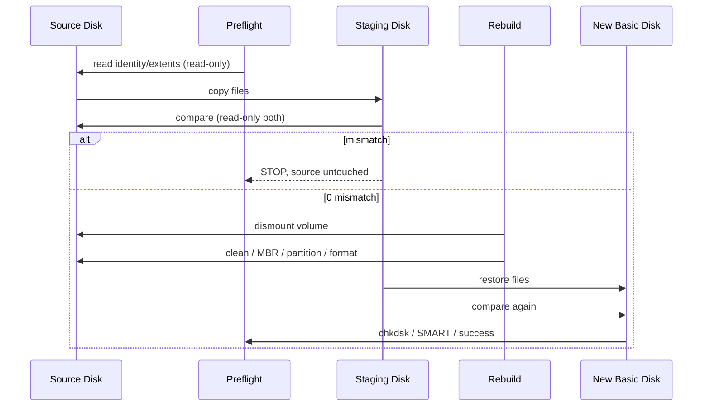

# 02. 架构与数据流

## 1. 组件

```text
┌─────────────────────────────────────────────────────────────┐
│                      Orchestrator / Runbook                 │
│  身份门禁 · 阶段状态 · 失败关闭 · 证据记录 · 人工确认        │
└───────────────┬─────────────────────────────────────────────┘
                │
    ┌───────────┼───────────┬────────────┬────────────┐
    ▼           ▼           ▼            ▼            ▼
 Preflight   CopyData   CompareTrees  Rebuild     RestoreData
 只读检查    Robocopy   TreeCompare   DiskPart     Robocopy
    │           │           │            │            │
    └───────────┴───────────┴────────────┴────────────┘
                            │
                    PostCheck / Reports
```

### 1.1 Preflight

只读收集：

- 物理磁盘型号、序列号、固件、容量；
- MBR/GPT 分区样式；
- 动态/基本状态；
- 卷、盘符、文件系统、健康状态；
- 卷的 extent 列表；
- 是否启动盘/系统盘；
- 暂存盘空间；
- 恢复目录/镜像是否存在。

输出 JSON，作为后续阶段的“身份基线”。

### 1.2 CopyData

使用 Robocopy 把源卷复制到暂存目录：

```text
robocopy <SOURCE> <STAGING> /E /COPYALL /DCOPY:DAT /SEC /B /XJ /R:1 /W:1
```

要点：

- `/E` 包含子目录（含空目录）；
- `/COPYALL` 保留数据、属性、时间戳、ACL、所有者、审计信息；
- `/DCOPY:DAT` 保留目录时间；
- `/B` 备份模式（需要备份权限/管理员）；
- `/XJ` 跳过 junction，避免循环；
- `/R:1 /W:1` 避免在锁定文件上长时间重试；
- 不使用 `/MIR`、`/PURGE`，避免删除暂存盘上的额外文件。

> `/MT` 与 `/IPG`、`/EFSRAW` 存在兼容性限制。不要为了“更快”盲目叠加参数。

### 1.3 CompareTrees

`TreeCompare.cs` 在 C# 中完成：

1. 递归枚举源和目标（跳过 `System Volume Information`、`$RECYCLE.BIN`、reparse point）；
2. 建立相对路径字典；
3. 比较路径类型、文件长度；
4. 对每个文件按 1 MiB 缓冲读取，比较字节；
5. 记录 mismatch；
6. 每 N 个文件写一次进度 CSV。

进度 CSV：

```text
CheckedAt,SourceBytesChecked,FilesChecked,Mismatches
```

它既用于判断是否通过，也用于计算速度和 ETA。

### 1.4 RebuildBasicVolume

危险阶段。顺序：

1. 再次确认目标序列号；
2. 安全卸载源卷（`fsutil volume dismount`）；
3. 确认卷已不在线；
4. 用 `diskpart /s` 执行：

   ```text
   select disk <N>
   attributes disk clear readonly
   clean
   exit
   ```

5. 等待磁盘重新枚举；
6. 如果 `PartitionStyle=RAW`，初始化 MBR；
7. 创建占满整盘的主分区；
8. 分配盘符；
9. 格式化为 NTFS（4 KiB 簇）；
10. 记录 `SUCCESS` 前的中间状态。

### 1.5 RestoreData

从暂存目录回拷到新基本盘：

```text
robocopy <STAGING> <TARGET> /E /COPYALL /DCOPY:DAT /SEC /B /XJ /R:1 /W:1
```

然后再次运行 CompareTrees，方向为 `Staging → Target`。

### 1.6 PostCheck

只读检查：

- `Get-Disk`：PartitionStyle 必须为 MBR；
- `Get-Partition`：目标盘存在 E: 分区；
- `Get-Volume`：NTFS/Healthy；
- 文件数/目录数/字节数；
- `chkdsk /scan`：无问题、0 坏扇区；
- SMART：读取错误计数；
- 事件日志：disk Event ID 7 等；
- 写入 `SUCCESS.json`。

## 2. 数据流



## 3. 状态机

```text
PreflightPassed
  → ProcessesStopped
  → SourceCopied
  → SourceVerified
  → AboutToWipe
  → Wiped
  → ConvertedToBasic
  → RestoreCopied
  → RestoreVerified
  → Complete

任意阶段异常 → Failed
```

状态文件必须包含：

- `RunStamp`（本次运行唯一标识）；
- `Stage`；
- `UpdatedAt`；
- `SourceSerial`；
- `SourceDestroyed`；
- `RunMode`；
- 失败原因/日志路径。

> 旧运行的 `FAILED-*.json` 不能被新运行误判。所有标记都要按 `RunStamp` 和创建时间过滤。

## 4. 为什么需要暂存盘

- 重建基本盘必须清空目标盘；
- 不能把唯一数据留在目标盘上；
- 暂存盘同时用于“回拷源”和“失败回退”；
- 暂存盘可以是独立 HDD/SSD，但必须是健康、容量足够、非目标盘。

## 5. 为什么比较两次

- 第一次：证明暂存副本完整，才有资格清盘；
- 第二次：证明回拷后的新基本盘完整，才能宣称成功。

只比较一次不足以覆盖“回拷阶段”的错误。

## 6. 为什么用 `diskpart /s`

DiskPart 是交互式程序。启动后立刻向 stdin 写命令，存在时序风险：第一条命令可能未被正确解析，后续命令报“没有选择磁盘”。

`diskpart /s <file>`：

- 命令一次性写入文件；
- DiskPart 自己按顺序读取；
- 进程退出码和完整 stdout 可捕获；
- 便于审计和复现。

详细故障见 `06-diskpart-postmortem.md`。
